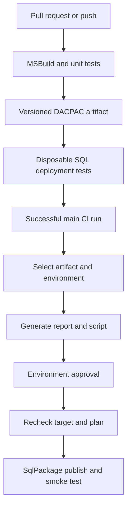

# SQL Server Database CI/CD

**MSBuild → DACPAC → deployment report/script → approved SqlPackage publish → smoke test.**

[](https://github.com/nithin-gadicharla/SQLServer-Database-CICD/actions/workflows/ci.yml)

A complete working example for SQL Server schema delivery, with a sample customer/order database, artifact provenance, explicit target checks, deployment-plan review, and live integration tests. Real server promotion is configurable and disabled until you provide environment settings. See [validation evidence](docs/VALIDATION.md) for what has actually run.

## Included

| Area | Implementation |
| --- | --- |
| Database source | SDK-style SQL project, two tables, constraints/index, stored procedure and aggregate view |
| Build | MSBuild engine via `dotnet msbuild`, Microsoft.Build.Sql 2.3.0, SQL Server 2022 target |
| Publish | Pinned SqlPackage 170.5.96; Windows workflow explicitly invokes `sqlpackage.exe` |
| CI | Windows build/unit tests and Windows executable check; Linux SQL Server deployment lifecycle tests |
| CD | Promote the same successful CI artifact to Dev, Test or Prod without rebuilding |
| Review | XML report, executable SQL script and receipt tying source/package/target/plan together |
| Protection | Validated TLS, system-database rejection, exact target checks, data-loss blocking, drops disabled |
| Evidence | DACPAC checksum manifest, CI run provenance, deployment receipts, tested failure cases |

## Pipeline



Environment approval must be configured in GitHub settings; a workflow file alone does not create approval protection. Dev/Test/Prod are selectable destinations; this example does not automatically prove an earlier environment was approved or deployed.

## Local build

Prerequisites: .NET 10 SDK, PowerShell 7.2+, Git, NuGet access. A full Visual Studio installation is not required for the default SDK-style build.

```powershell
$commit = (git rev-parse HEAD).Trim()
./scripts/Build-Database.ps1 -Commit $commit
# Equivalent MSBuild engine invocation:
dotnet msbuild src/ApplicationDb/ApplicationDb.sqlproj /restore /t:Rebuild /p:Configuration=Release
```

The wrapper produces `artifacts/package/ApplicationDb.dacpac` and `manifest.json`. `-MSBuildPath 'C:\path\MSBuild.exe'` is available on a host with a compatible MSBuild/SQL SDK installation; CI validates the default .NET SDK MSBuild path. Traditional SSDT projects require their own installed targets and are not the sample project format.

## Plan and publish with sqlpackage.exe

Provision the target **user database** separately. Configure a trusted SQL Server certificate and a connection string through your secret store or process environment; do not commit credentials. The target must be reachable from the runner.

```powershell
dotnet tool install Microsoft.SqlPackage --tool-path .tools --version 170.5.96
# Set DB_CONNECTION_STRING securely outside source control before these commands.
$commit = (Get-Content artifacts/package/manifest.json -Raw | ConvertFrom-Json).commit
./scripts/Deploy-Database.ps1 -Action Plan -PackageDirectory artifacts/package `
  -Environment dev -ExpectedServer 'sql-dev.example.com' -ExpectedDatabase 'ApplicationDb_Dev' `
  -ExpectedCommit $commit -OutputDirectory artifacts/review `
  -SqlPackagePath "$PWD/.tools/sqlpackage.exe"
# Review deploy-report.xml and deploy.sql before running Publish.
./scripts/Deploy-Database.ps1 -Action Publish -PackageDirectory artifacts/package `
  -Environment dev -ExpectedServer 'sql-dev.example.com' -ExpectedDatabase 'ApplicationDb_Dev' `
  -ExpectedCommit $commit -OutputDirectory artifacts/published `
  -ApprovedReceipt artifacts/review/receipt.json -SqlPackagePath "$PWD/.tools/sqlpackage.exe"
./scripts/Test-Database.ps1 -SqlFile tests/sql/Smoke.sql
```

On Linux/macOS, `dotnet tool restore` installs the pinned local tool and the deployment wrapper uses `dotnet tool run sqlpackage` when no executable path is supplied. `-WhatIf` validates local artifact and target settings without connecting or publishing. In CI, `-Confirm:$false` delegates approval to configured GitHub environment protection.

## Configure actual deployment

Follow [environment setup](docs/ENVIRONMENT_SETUP.md). Provide server/database names, authentication method, network/runner requirements and environment approvers. Store credentials in GitHub environment secrets or an approved secret manager. **Do not paste passwords into issues or this repository.**

The deploy workflow requires a successful `push` CI run on `main`, its exact source commit, and environment selection. It downloads that run's DACPAC, verifies the checksum, generates a plan, pauses at the configured deployment environment, then regenerates and compares the plan before publishing.

## Test

```powershell
Install-Module Pester -RequiredVersion 5.7.1 -Scope CurrentUser
Invoke-Pester tests/Unit.Tests.ps1 -CI
```

CI deploys to a disposable SQL Server 2022 container using validated TLS. It tests initial deployment, repeat publishing, stored-procedure/view behavior, additive schema upgrade with existing-data preservation, and blocking an unsafe narrowing change. It never connects to a user server without configuration.

## Important limits

DACPAC deployment is schema comparison, not a universal data-migration or rollback engine. A previous DACPAC does not restore deleted or transformed data. Use reviewed expand/contract migrations, backups and restore drills for recovery. Data-loss flags do not protect arbitrary pre/post-deployment SQL. This sample intentionally contains no production data seeding or unmanaged migration scripts.

Plan fingerprints compare reported operations and alerts, not the complete target state. Out-of-band changes can still occur after validation and before execution. Review locking, table rebuilds, timeouts, permissions, deployment windows and application compatibility for your actual database. The smoke test rolls back its rows but can advance identity values; replace it with application-specific checks when adapting the sample.

See [architecture](docs/ARCHITECTURE.md), [recovery runbook](docs/RECOVERY.md), [project summary](PROJECT_SUMMARY.md), and [security](SECURITY.md). Implementation was prepared with AI assistance. No production deployment, independent adoption or operational outcome is implied by publishing this repository.
